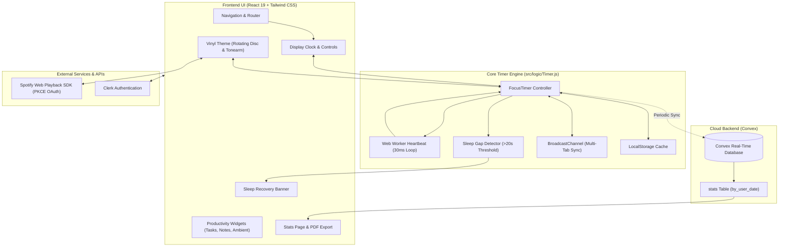
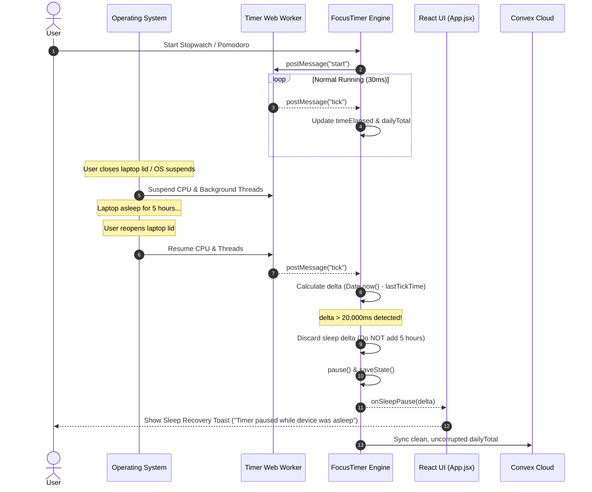
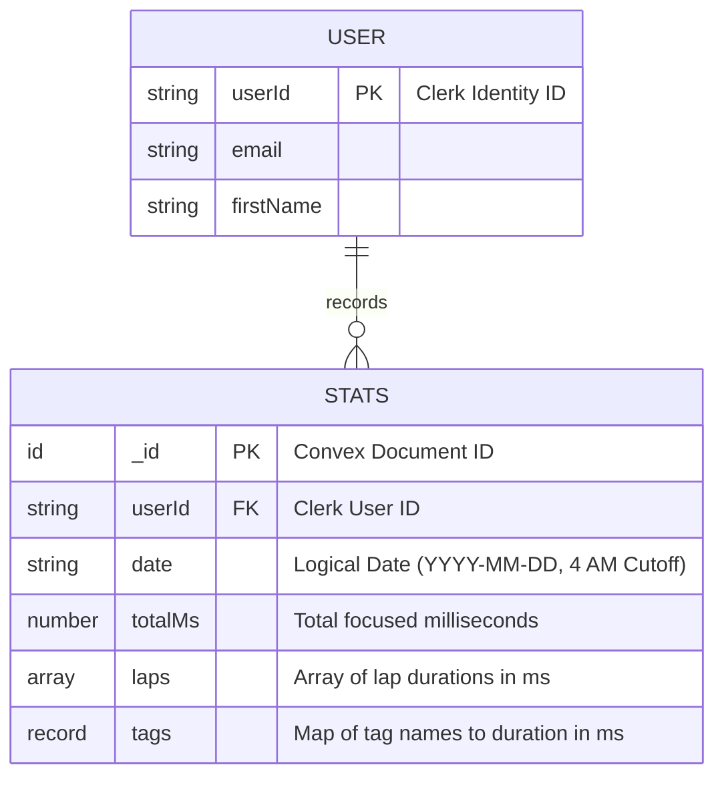

# Focus10010 (VibeCodedTimer)

> An aesthetic, ambient focus timer and productivity sanctuary featuring integrated Spotify playback, realistic vinyl animation, ambient audio, real-time Convex cloud synchronization, and background-safe sleep recovery.

---

## Architecture Overview



---

## Features

- **Multi-Mode Focus Timing:**
  - **Pomodoro:** Customizable focus sessions with auto-chaining to breaks.
  - **Short / Long Break:** Rest intervals with completion chimes and desktop notifications.
  - **Stopwatch:** High-precision stopwatch with lap recording and real-time lap tables.
- **Sleep & Suspend Auto-Pause:**
  - Discards unearned elapsed time when laptop lid closes or system suspends.
  - Automatically pauses and preserves clean daily focus stats.
- **Background-Safe Web Worker:**
  - Bypasses browser background tab throttling so timers tick accurately across open tabs.
- **Interactive Vinyl Player & Spotify Integration:**
  - Full Spotify Web Playback SDK support via PKCE OAuth.
  - Animated vinyl turntable with dynamically centered album art, tonearm tracking, seek bar, and volume controls.
- **Ambient Soundscapes & Widgets:**
  - Multi-track ambient sound generator (white noise, rain, lo-fi beats).
  - Minimalist Quick Notes and Daily Todo widgets.
  - Daily Goal Ring, Streak Badges, and jsPDF Focus Report export.
- **Real-Time Cloud Persistence:**
  - Convex cloud database synchronization for daily focus totals, lap histories, and task tags.
  - Cross-tab state synchronization via `BroadcastChannel`.

---

## Timer State Machine

```mermaid
stateDiagram-v2
    [*] --> Idle

    Idle --> Stopwatch : Select Stopwatch
    Idle --> Pomodoro : Select Focus Mode
    Idle --> Break : Select Break

    state Stopwatch {
        [*] --> SwRunning : Start
        SwRunning --> SwRunning : Lap Recorded
        SwRunning --> SwPaused : Pause
        SwPaused --> SwRunning : Resume
        SwPaused --> [*] : Reset
    }

    state Pomodoro {
        [*] --> PomoRunning : Start
        PomoRunning --> PomoPaused : Pause
        PomoPaused --> PomoRunning : Resume
        PomoRunning --> PomoComplete : Time Expires (00:00)
        PomoComplete --> Break : Auto-Chain Enabled
        PomoPaused --> [*] : Reset
    }

    state Break {
        [*] --> BreakRunning : Start
        BreakRunning --> BreakPaused : Pause
        BreakPaused --> BreakRunning : Resume
        BreakRunning --> BreakComplete : Time Expires (00:00)
        BreakComplete --> Pomodoro : Auto-Chain Enabled
        BreakPaused --> [*] : Reset
    }

    SwRunning --> Suspended : Device Sleeps (Gap > 20s)
    PomoRunning --> Suspended : Device Sleeps (Gap > 20s)
    BreakRunning --> Suspended : Device Sleeps (Gap > 20s)

    Suspended --> SwPaused : Wake Up (Discard Gap)
    Suspended --> PomoPaused : Wake Up (Discard Gap)
    Suspended --> BreakPaused : Wake Up (Discard Gap)
```

---

## Device Sleep & Wake Recovery Flow

When a laptop lid closes or the operating system suspends, JavaScript execution freezes. The diagram below illustrates how Focus10010 prevents false time inflation:



---

## Data Model



---

## Tech Stack

| Layer | Technologies |
|---|---|
| **Frontend Framework** | React 19, Vite 8 |
| **Styling** | Tailwind CSS v4, Material Symbols |
| **Backend & Real-Time Sync** | [Convex](https://convex.dev) |
| **Authentication** | [Clerk](https://clerk.com) |
| **Music Streaming** | Spotify Web Playback SDK, `@spotify/web-api-ts-sdk` |
| **Reporting & Charts** | Recharts, jsPDF, jsPDF-AutoTable |
| **PWA & Offline** | Vite PWA Plugin, Service Workers, Web Workers |

---

## Getting Started

### Prerequisites

- **Node.js**: v18+ or v20+ recommended
- **npm** or **pnpm**
- **Convex Account**: [convex.dev](https://convex.dev)
- **Clerk Account**: [clerk.com](https://clerk.com)
- **Spotify Developer App**: [developer.spotify.com](https://developer.spotify.com)

### Environment Setup

Create a `.env.local` file in the project root:

```env
# Clerk Authentication
VITE_CLERK_PUBLISHABLE_KEY=pk_test_...

# Convex Deployment
VITE_CONVEX_URL=https://...convex.cloud

# Spotify Web API
VITE_SPOTIFY_CLIENT_ID=your_spotify_client_id
```

### Installation

```bash
# Clone the repository
git clone https://github.com/your-username/VibeCodedTimer.git
cd VibeCodedTimer

# Install dependencies
npm install

# Run Convex development backend
npx convex dev

# Start Vite development server
npm run dev
```

### Available Scripts

- `npm run dev` — Starts the local Vite development server.
- `npm run build` — Deploys Convex functions and builds production frontend bundle.
- `npm run preview` — Locally previews the production build.
- `npm run lint` — Runs ESLint checks.

---

## License

This project is licensed under the [MIT License](LICENSE).
